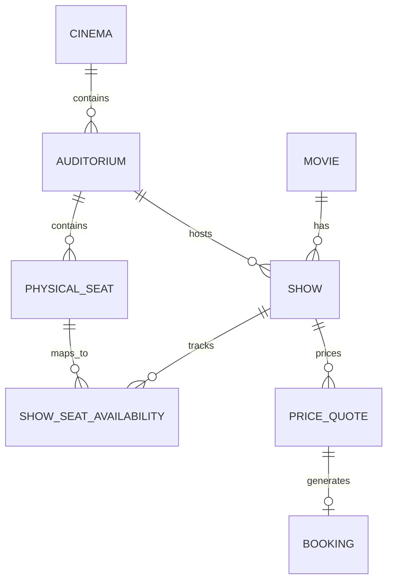
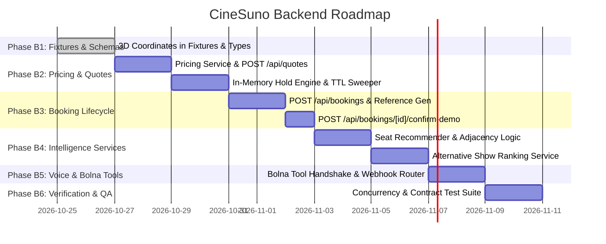

# CineSuno — Developer B (Backend Lead) Master Implementation Plan

**Document:** `CINESUNO_BACKEND_PLAN.md`  
**Author:** Developer B (Backend Lead)  
**Collaborator:** Developer A (Frontend Lead)  
**Version:** 1.0  
**Stack:** Next.js 16 Route Handlers, TypeScript 5, Node.js runtime, In-Memory Server Store, Bolna Voice Tool Handler

---

## 1. Role Scope & Ownership Boundaries

As Developer B, I am responsible for implementing the authoritative domain core of CineSuno: mock catalogue ingestion, localized showtime schedules, 3D auditorium coordinate mapping, deterministic seat recommendation algorithms, pricing and fee validation, booking lifecycle state transitions, concurrency safety, Next.js API route handlers, and Bolna voice agent tool execution.

### Primary File Ownership
- `src/app/api/**` (All Next.js route handlers: `/api/movies/**`, `/api/shows/**`, `/api/seats/**`, `/api/quotes/**`, `/api/bookings/**`, `/api/voice/**`)
- `src/lib/data-store.ts` (Catalogue fixture reader and in-memory demo data store)
- `src/lib/booking-state.ts` (Server-side in-memory booking store, seat hold locks, TTL timers)
- `src/lib/movie-search.ts` (Movie and showtime filtering & natural-language search logic)
- `src/lib/pricing.ts` (Seat tier pricing, convenience fee calculation, and quote generation)
- `src/lib/seat-recommender.ts` (Deterministic best-available seat selection algorithms)
- `src/lib/booking-engine.ts` (Booking lifecycle engine: create, hold, lock, confirm, expire)
- `src/lib/voice-tools.ts` (Bolna tool definitions, parameter schemas, and execution handlers)
- `src/lib/validation.ts` (Request schema validation and input sanitization)
- `data/**` (Local mock JSON fixtures: movies, cinemas, showtimes, auditoriums, seats)

### Protected Shared Files (Requires Agreement with Developer A Before Modifying)
- `src/types/index.ts`
- `src/app/globals.css`
- `src/app/layout.tsx`
- `package.json` & `package-lock.json`
- `tsconfig.json`, `next.config.ts`, `eslint.config.mjs`

---

## 2. Architecture & Data Store Strategy

### 2.1 Persistence Strategy: In-Memory Demo Store + Immutable Fixtures
In strict compliance with CineSuno's scope restrictions, no external database (PostgreSQL, Supabase, Prisma, MongoDB) or external cloud infrastructure is used.
- **Catalogue Fixtures (`data/*.json`):** Read-only at runtime. Contains curated movies, multiplex chains, auditoriums, and base seat maps.
- **Server-Side Mutable State (`src/lib/booking-state.ts`):** Managed in an in-memory singleton module. Stores active price quotes, held seats with expiry timestamps, confirmed bookings, and simulated customer records.
- **Lifecycle Cleanup Worker:** An automated in-process timer sweeps the store every 30 seconds to transition expired quotes (`status: 'expired'`) and release held seats back to `available`.

### 2.2 Domain Entities & Schemas



1. **Movie (`data/movies.json`):** `id`, `title`, `languages[]`, `genres[]`, `runtimeMinutes`, `certificate`, `synopsis`, `poster`, `status`, `rating`.
2. **Cinema (`data/cinemas.json`):** `id`, `name`, `address`, `city`, `facilities[]`.
3. **Auditorium / Screen (`data/auditoriums.json`):** `id`, `cinemaId`, `name`, `format` (`2D`, `3D`, `IMAX`), `screenDimensions` (`width`, `height`, `curveRadius`), `screenCoordinates` (`x`, `y`, `z`).
4. **Physical Seat (`data/seats.json`):** `id`, `auditoriumId`, `row`, `number`, `category` (`standard`, `premium`, `recliner`), `zone` (`front`, `middle`, `back`), `coordinates3D` (`x`, `y`, `z` in meters), `viewScore` ($0$–$100$), `aisle`.
5. **Show (`data/shows.json`):** `id`, `movieId`, `cinemaId`, `auditoriumId`, `startTime`, `ticketPricePaise`, `status`, `format`, `language`.
6. **PriceQuote (In-Memory):** `id`, `showId`, `seatIds[]`, `ticketCount`, `subtotalPaise`, `convenienceFeePaise`, `totalPaise`, `expiresAt`, `status` (`active`, `expired`, `consumed`).
7. **Booking (In-Memory):** `id`, `reference` (`CS-XXXX-XX`), `showId`, `seatIds[]`, `quoteId`, `ticketCount`, `totalPaise`, `status` (`pending_confirmation`, `confirmed`, `expired`), `customer`, `confirmedAt`.

---

## 3. Authoritative Domain & Business Rules

Every backend route and service strictly enforces the following non-negotiable invariants:

### 3.1 Integer Paise for Currency
All prices, subtotals, fees, and totals are computed and stored as integer Indian paise ($1\text{ Rupee} = 100\text{ paise}$).
- Example: A ticket priced at ₹250.00 is represented as `25000` paise.
- Zero floating-point operations are permitted in pricing services.

### 3.2 Convenience Fee Policy
The convenience fee is exactly ₹5 (500 paise) per ticket, strictly capped at a maximum of ₹30 (3000 paise) per booking transaction:
$$\text{convenienceFeePaise} = \min(\text{ticketCount} \times 500,\, 3000)$$

### 3.3 Ticket Count Boundaries
- Minimum: 1 ticket. Maximum: 20 tickets per booking transaction.
- Zero, negative, fractional, or counts $>20$ are rejected immediately with `INVALID_TICKET_COUNT` (`400 Bad Request`).

### 3.4 Zero Client Trust & Server Authoritative State
- The backend never trusts prices, totals, discounts, or availability submitted by the browser or AI agent text.
- Availability is checked atomically when generating a quote and re-verified before creating a booking.
- A quote is valid for exactly 300 seconds (5 minutes). Once `expiresAt` passes, attempts to create a booking are rejected with `QUOTE_EXPIRED` (`409 Conflict`).

### 3.5 Seat State Lifecycle & Concurrency
- `available` $\rightarrow$ `held` (upon successful quote generation, held for 5 minutes) $\rightarrow$ `booked` (upon demo payment confirmation).
- If a user cancels or the quote expires, held seats immediately revert to `available`.
- Requests attempting to select already booked or held seats are rejected with `SEAT_UNAVAILABLE` (`409 Conflict`).

---

## 4. API Endpoints Implementation Plan

All endpoints strictly adhere to the standard JSON response envelope `ApiResponse<T>`:

```typescript
// Success (200 OK, 201 Created)
{ "success": true, "data": T, "message"?: string }

// Failure (400, 404, 409, 422, 500)
{ "success": false, "error": { "code": ApiErrorCode, "message": string, "field"?: string } }
```

### 4.1 Catalogue & Discovery Endpoints
1. `GET /api/movies`
   - **Query Params:** `query` (search term), `language`, `genre`, `status` (`now_showing`, `coming_soon`).
   - **Service:** `src/lib/movie-search.ts:searchMovies`.
2. `GET /api/movies/[id]`
   - Returns full movie metadata, director, synopsis, and active languages.
3. `GET /api/shows`
   - **Query Params:** `movieId`, `cinemaId`, `date` (`YYYY-MM-DD`), `city`.
   - Returns schedule of matching shows with current `status` (`scheduled`, `filling_fast`, `sold_out`).

### 4.2 Seat Map & 3D Spatial Endpoints
4. `GET /api/shows/[id]/seats`
   - **Response Payload:** `ShowSeatMapResponse` containing:
     - `show`, `movie`, `cinema`.
     - `auditorium`: Screen dimensions, curve radius, and 3D screen origin $(x, y, z)$.
     - `seats[]`: List of physical seats enriched with 3D coordinates $(x, y, z)$, tier name, calculated price in paise, and current show-specific status (`available`, `held`, `booked`).
5. `POST /api/seats/recommend`
   - **Body:** `{ showId, seatCount, adjacentSeatsOnly, preferredZone, preferredCategory, maxBudgetPaise }`.
   - **Service:** `src/lib/seat-recommender.ts:recommendSeats`.
   - **Algorithm:** Scans auditorium matrix for contiguous available seats in the requested tier/zone, ranking by central viewing score and proximity to optimal acoustic center.

### 4.3 Pricing Quotes & Booking Lifecycle Endpoints
6. `POST /api/quotes`
   - **Body:** `{ showId: string, seatIds: string[] }`.
   - **Validation:** Verifies $1 \le \text{seatCount} \le 20$. Verifies all seat IDs belong to the show and are currently `available`.
   - **Action:** Atomically places a 5-minute hold on the seats in `src/lib/booking-state.ts`. Calculates subtotal, convenience fee, and returns `PriceQuote` with `expiresAt`.
7. `POST /api/bookings`
   - **Body:** `{ quoteId: string, showId: string, seatIds: string[], customer?: CustomerInfo }`.
   - **Validation:** Verifies `quoteId` is active, unexpired, and matches the requested `seatIds`.
   - **Action:** Generates booking record with status `pending_demo_payment`, human-readable reference code (e.g. `CS-7842-M3`), and returns `Booking`.
8. `GET /api/bookings/[id]`
   - Returns booking record with current state and ticket breakdown.
9. `POST /api/bookings/[id]/confirm-demo`
   - **Body:** `{ paymentMethod?: 'UPI' | 'CARD' | 'WALLET' | 'DEMO' }`.
   - **Action:** Transitions booking to `confirmed`, transitions seats to `booked`, records simulated payment reference, and returns `ConfirmDemoPaymentResponse`.

### 4.4 Intelligence & Voice Endpoints
10. `POST /api/shows/[id]/alternatives`
    - **Body:** `{ partySize: number, maxBudgetPaise?: number, preferredTimeOfDay?: string }`.
    - **Service:** Deterministic multi-attribute scoring engine evaluating candidate shows for the same movie by time proximity, price difference, seat availability, and cinema continuity.
11. `POST /api/voice/webhook`
    - Bolna tool-calling dispatcher receiving vocal function invocations (`search_movies`, `find_shows`, `recommend_seats`, `create_quote`, `confirm_booking`).

---

## 5. 3D Auditorium Backend Data Specification

To support Developer A's interactive 3D auditorium and Web Audio spatial simulation, `data/seats.json` and `GET /api/shows/[id]/seats` must supply standardized 3D coordinates in meters:

### Coordinate System (Right-Handed Cartesian)
- **Origin $(0, 0, 0)$:** Center of the auditorium floor directly in front of the screen.
- **$X$-Axis:** Horizontal width across the hall (Negative = Left, Positive = Right). Range: $-8.0\text{m}$ to $+8.0\text{m}$.
- **$Y$-Axis:** Elevation height (Floor rake). Rises $0.4\text{m}$ per row towards the rear. Range: $0.5\text{m}$ to $4.5\text{m}$.
- **$Z$-Axis:** Distance from screen to rear. Screen is at $Z = -15.0\text{m}$; Row A starts at $Z = 0.0\text{m}$; rear Recliners reach $Z = +14.0\text{m}$.

### Data Schema Enhancement in `Seat`:
```typescript
export interface SeatCoordinates3D {
  x: number; // In meters relative to hall centerline
  y: number; // In meters elevation from floor datum
  z: number; // In meters distance from hall origin
}

export interface Seat {
  id: string;
  cinemaId: string;
  auditoriumId: string;
  row: string;
  number: number;
  zone: 'front' | 'middle' | 'back';
  category: 'standard' | 'premium' | 'recliner';
  coordinates3D: SeatCoordinates3D;
  viewScore: number; // 0 - 100
  aisle: boolean;
}
```

---

## 6. Intelligence Services & Voice Tools

### 6.1 Reusable Pure TypeScript Domain Services
All core business logic resides in framework-agnostic TypeScript files in `src/lib/`:
1. `src/lib/pricing.ts`:
   - `calculateSeatPrice(basePricePaise, category)`
   - `calculateConvenienceFee(ticketCount)`
   - `generateQuote(show, seats)`
2. `src/lib/seat-recommender.ts`:
   - `findOptimalAdjacentSeats(hall, showAvailability, count, category)`
3. `src/lib/alternative-finder.ts`:
   - `scoreAlternativeShows(targetShow, allShows, constraints)`
4. `src/lib/movie-search.ts`:
   - `filterCatalogue(movies, searchParams)`
   - `parseNaturalLanguageIntent(queryText)`

### 6.2 Bolna Voice Agent Tool Definitions
Exposed via `src/lib/voice-tools.ts`:
- `tool_search_movies`: Arguments `{ query, language, genre }` $\rightarrow$ calls `movie-search.ts`.
- `tool_get_showtimes`: Arguments `{ movieId, date, city }` $\rightarrow$ calls `data-store.ts`.
- `tool_recommend_seats`: Arguments `{ showId, ticketCount, category }` $\rightarrow$ calls `seat-recommender.ts`.
- `tool_get_price_quote`: Arguments `{ showId, seatIds }` $\rightarrow$ calls `pricing.ts`.
- `tool_confirm_booking`: Arguments `{ bookingId, userConfirmation: true }` $\rightarrow$ calls `booking-engine.ts`.

---

## 7. Backend Phased Implementation Plan



### Phase B1: 3D Seat Fixtures & Contract Alignment
- **Tasks:** Enrich `data/seats.json` and `data/auditoriums.json` with realistic 3D Cartesian coordinates $(x, y, z)$ and screen positions; update `ShowSeatMapResponse` to include auditorium dimensions.
- **Files:** `data/seats.json`, `data/auditoriums.json`, `src/types/index.ts`.
- **Verification:** Validate JSON schemas and run `npx tsc --noEmit`.

### Phase B2: Pricing Engine & Quote Hold Lifecycle
- **Tasks:** Build `src/lib/pricing.ts` enforcing integer paise and the ₹5/ticket fee cap of ₹30; implement `src/lib/booking-state.ts` holding seats for 300 seconds; implement `POST /api/quotes`.
- **Files:** `src/lib/pricing.ts`, `src/lib/booking-state.ts`, `src/app/api/quotes/route.ts`.
- **Verification:** Unit test pricing boundary conditions (1 ticket = 500 paise, 6 tickets = 3000 paise, 10 tickets = 3000 paise).

### Phase B3: Booking Creation & Confirmation Engine
- **Tasks:** Implement `POST /api/bookings`, `GET /api/bookings/[id]`, and `POST /api/bookings/[id]/confirm-demo`; generate alphanumeric references (`CS-XXXX-XX`); enforce explicit confirmation guard.
- **Files:** `src/lib/booking-engine.ts`, `src/app/api/bookings/route.ts`, `src/app/api/bookings/[id]/confirm-demo/route.ts`.
- **Verification:** Test successful confirmation, expired quote rejection, and duplicate booking prevention.

### Phase B4: Seat Recommender & Alternate Shows Service
- **Tasks:** Implement `src/lib/seat-recommender.ts` solving contiguous group seating; implement `POST /api/shows/[id]/alternatives` ranking nearby/earlier/cheaper shows.
- **Files:** `src/lib/seat-recommender.ts`, `src/app/api/seats/recommend/route.ts`, `src/app/api/shows/[id]/alternatives/route.ts`.
- **Verification:** Test 1–20 ticket requests with various budget and zone filters.

### Phase B5: Bolna Voice Tools & Intent Webhook
- **Tasks:** Implement `src/lib/voice-tools.ts` exposing structured tools for the Bolna agent; implement `/api/voice/webhook` routing voice commands directly to the core domain services.
- **Files:** `src/lib/voice-tools.ts`, `src/app/api/voice/webhook/route.ts`.
- **Verification:** Test tool-calling execution with simulated Bolna payload.

### Phase B6: Verification & Integration Verification
- **Tasks:** Execute complete test suite: verify status codes, bad input sanitization, quote expiration, and concurrency safety.
- **Verification:** Run `npm run lint`, `npx tsc --noEmit`, and `npm run build`.
