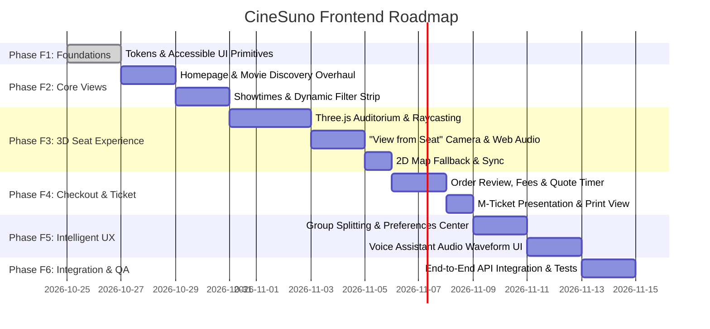

# CineSuno — Developer A (Frontend Lead) Master Implementation Plan

**Document:** `CINESUNO_FRONTEND_PLAN.md`  
**Author:** Developer A (Frontend Lead)  
**Collaborator:** Developer B (Backend Lead)  
**Version:** 1.0  
**Stack:** Next.js 16 App Router, React 19, TypeScript 5, Tailwind CSS v4, WebGL / Three.js, Web Audio API

---

## 1. Role Scope & Ownership Boundaries

As Developer A, I am responsible for delivering the entire customer-facing experience for CineSuno: visual design, accessible interaction primitives, responsive layouts, client routing, the interactive 3D seat auditorium, simulated spatial audio, intelligent booking UX widgets, and client-side integration via the typed API client.

### Primary File Ownership
- `src/app/page.tsx` (Homepage & discovery portal)
- `src/app/movies/**` (Movie detail & media routes)
- `src/app/shows/**` (Showtime picker & cinema selection routes)
- `src/app/checkout/**` (Order review, simulated payment & checkout modal)
- `src/app/booking/**` (Booking history & electronic M-Ticket presentation)
- `src/components/**` (All React UI components, 3D canvas, audio widgets, drawers, modals)
- `src/lib/api-client.ts` (Typed HTTP client calling backend API endpoints)
- `src/lib/preferences.ts` (Browser local preference memory)
- `src/lib/cost-calculator.ts` (Client-side fee calculation & comparison helper)
- `src/lib/alternative-finder.ts` (Client-side alternate show ranking fallback)
- `src/lib/speech-recognition.ts` (Browser Web Speech API assistant integration)
- `src/mocks/**` (Isolated client mock adapters used during independent UI design)

### Protected Shared Files (Requires Agreement with Developer B Before Modifying)
- `src/types/index.ts`
- `src/app/globals.css`
- `src/app/layout.tsx`
- `package.json` & `package-lock.json`
- `tsconfig.json`, `next.config.ts`, `eslint.config.mjs`

---

## 2. Design System & UI Foundations

### 2.1 Monochromatic Green Color Tokens
CineSuno uses a bespoke monochromatic green identity anchored on `#356B62`. All components consume semantic CSS variables rather than hardcoded hex values:

```css
/* Light Theme Tokens */
--color-brand: #356B62;
--color-brand-hover: #28574F;
--color-app-bg: #F5F7F6;
--color-surface: #FFFFFF;
--color-surface-elevated: #EAF0ED;
--color-text-primary: #1B2925;
--color-text-secondary: #53645E;
--color-border-subtle: #D5DFDA;
--color-surface-selected: #DDE9E5;
--color-focus-ring: #356B62;

/* Dark Theme Tokens */
--color-brand: #83B5A8;
--color-brand-hover: #A0C9BE;
--color-app-bg: #111917;
--color-surface: #1B2522;
--color-surface-elevated: #24312C;
--color-text-primary: #E4EFEB;
--color-text-secondary: #B1C2BC;
--color-border-subtle: #354740;
--color-surface-selected: #293A34;
--color-focus-ring: #83B5A8;
```

### 2.2 Typography & Layout Rules
- **Typography:** Geist / Inter sans-serif font stack. Headings use bold/extrabold ($700$–$800$), body uses regular/medium ($400$–$500$), badges use uppercase tracking ($0.05\text{em}$).
- **Iconography:** Lucide SVG icons (`src/components/icons/index.tsx`). **Zero emojis** anywhere in the product UI.
- **Imagery:** Real movie posters with strict 2:3 vertical aspect ratios (`/posters/*.jpg`) and 16:9 cinematic landscape banners with subtle gradient masks. All images utilize skeleton shimmer placeholders and error fallbacks.
- **Spacing Scale:** Multiples of $4\text{px}$ ($4, 8, 12, 16, 24, 32, 48, 64$).
- **Border Radius:** Primitives use rounded `$12\text{px}$` (`rounded-xl`), `$16\text{px}$` (`rounded-2xl`), or `$24\text{px}$` (`rounded-3xl`).

### 2.3 Reusable Component Primitives
Located under `src/components/ui/`:
1. `Button.tsx` (Variants: `primary`, `secondary`, `outline`, `ghost`, `danger`; sizes: `sm`, `md`, `lg`)
2. `CustomSelect.tsx` (Keyboard navigable custom dropdown with search filter)
3. `DatePickerStrip.tsx` (Horizontal scrollable calendar date strip with weekday, date, month)
4. `DialogModal.tsx` (Accessible dialog with backdrop blur, focus trap, Escape key handling)
5. `SlideDrawer.tsx` (Bottom sheet on mobile, slide-over drawer on desktop)
6. `Tooltip.tsx` (Lightweight hover popover with micro-arrow)
7. `Toast.tsx` (`useToast` hook for success, error, info notifications)
8. `TicketQuantitySelector.tsx` (Increment/decrement stepper supporting 1 to 20 tickets)

---

## 3. Screen Inventory & Component Architecture

### S01: City & Location Selector Modal (`LocationModal.tsx`)
- **Role:** Sets the geographical anchor (`selectedCity`). Required for localized cinema listings.
- **States:** Default (grid of top Indian metros: Mumbai, Delhi-NCR, Bengaluru, Hyderabad, Chennai, Ahmedabad, Pune, Kolkata), Searching (autocomplete filter), GPS Detecting (browser geolocation prompt).
- **Storage:** Persisted in `localStorage['cinesuno_selected_city']` with fallback to `"Bengaluru"`.

### S02: Homepage & Movie Discovery (`src/app/page.tsx`)
- **Header:** Brand logo, location button, natural language search bar, voice booking trigger, theme toggle, preferences button.
- **Hero Carousel:** 16:9 cinematic feature banners for blockbuster titles with quick "Book Tickets" CTA.
- **Now Showing Grid:** Filterable by Language (Telugu, Hindi, Tamil, English, Kannada) and Genre (Action, Sci-Fi, Drama, Comedy).
- **Coming Soon Rail:** Horizontal scroll of upcoming titles with countdown release dates.
- **Recommended For You Section:** Personalization rail dynamically generated when user preferences are configured.

### S03: Movie Detail Route (`src/app/movies/[id]/page.tsx` or Modal)
- **Visuals:** Full-width cinematic backdrop with darkened gradient overlay, 2:3 vertical poster card, censor badge (`UA`), runtime (`180 mins`), release date, and rating pill.
- **Content:** Synopsis, director, star cast carousel, trailer playback modal (YouTube embed with fallback poster).
- **Primary Action:** Sticky "Select Showtimes" bar navigating to showtimes view.

### S04: Cinema Listings & Showtime Matrix (`ShowtimePicker.tsx`)
- **Sticky Date Strip:** 7-day horizontal calendar with selection state and unavailable date badges.
- **Filter Bar:** Format chips (`All`, `2D`, `3D`, `IMAX`), Timing chips (`Morning`, `Afternoon`, `Evening`, `Night`), and "Cost Optimizer" drawer trigger.
- **Cinema Cards:** Theater name, location, facilities (`M-Ticket`, `F&B Available`), and showtime pills.
- **Showtime Pill States:** `Available` (green outline), `Fast Filling` (amber pill), `Almost Full` (red dot), `Sold Out` (strikethrough + "Find Alternatives" trigger).

### S05: Interactive 3D Seat Auditorium (`Auditorium3D.tsx`)
- *Dedicated technical workstream detailed in Section 4.*
- **Features:** 3D WebGL auditorium, interactive seat nodes, tier dividers (`Recliner`, `Prime`, `Classic`), screen anchor, orbit controls, "View from this seat" camera mode, and simulated spatial audio.
- **2D Accessible Fallback:** Pure SVG/HTML 2D seat map (`SeatMap2D.tsx`) toggled via an accessible "Switch to 2D Map" button or automatically when WebGL is unaccelerated.

### S06: Booking Review & Simulated Checkout (`CheckoutModal.tsx`)
- **Booking Summary:** Movie, theater, screen name, date, time, seat badges (`B4, B5`).
- **Quote Timer:** 5-minute countdown pill tied to the server quote expiration.
- **Itemized Pricing:** Base ticket subtotal, ₹5/ticket convenience fee capped at ₹30, additional charges (if any), total payable amount in integer paise.
- **Simulation Notice:** Clear demo banner stating *"Demo Booking — No Real Payment Collected"*.
- **Confirmation:** Explicit "Confirm Booking" button triggering simulated reservation.

### S07: Electronic M-Ticket & Confirmation (`BookingConfirmation.tsx`)
- **Presentation:** High-contrast ticket container modeled after cinema turnstile scanners.
- **Elements:** Booking Reference (`CS-8921-X9`), dynamic mock QR code container, screen/audi number, seat list, entry rules, and "Download Ticket" (PDF/image print export).

### S08: Personal Preferences Center (`UserPreferencesModal.tsx`)
- **Options:** Favorite genres, preferred languages, budget target per ticket, preferred showtimes, seat tier preference, and accessibility needs (wheelchair access).
- **Controls:** Save, Reset to Default, Clear All Data, and transparent privacy disclosure notice.

### S09: Group Booking & Expense Splitting (`GroupSplitDrawer.tsx`)
- **Party Selector:** Select 1 to 20 tickets with group adjacency recommendations.
- **Split Calculation:** Equal split ($\text{Total} \div N$) or custom weighted split.
- **Share Summary:** "Copy Split Summary" action formatting shareable text with per-person share.

---

## 4. Mandatory 3D Auditorium & Audio Technical Workstream

### 4.1 WebGL Architecture Choice
- **Decision:** Use standard Three.js (`import * as THREE from 'three'`) instantiated inside a managed React canvas ref (`useRef<HTMLCanvasElement>`).
- **Rationale:** Avoids React 19 peer-dependency conflicts with `@react-three/fiber` while maintaining absolute control over rendering loops, memory disposal, and canvas resizing.
- **Bundle Strategy:** Code-split into a dynamic Next.js import (`dynamic(() => import('@/components/auditorium/Auditorium3D'), { ssr: false })`) so Three.js is never loaded on discovery or detail pages.

### 4.2 3D Scene Geometry
- **Screen:** Curved planar mesh at front of hall $(x: 0, y: 3.5, z: -18)$ with emissive white glow and cinema frame.
- **Auditorium Floor:** Sloped stadium rake geometry rising $0.4\text{m}$ per row towards the rear.
- **Seat Nodes:** Instanced or discrete rounded-box meshes colored by tier (`Recliner`: Gold `#C9A84E`, `Prime`: Brand `#356B62`, `Classic`: Slate `#64748B`).
- **Seat States:** Available (tier color), Selected (pulsing bright emerald with ring), Booked (muted dark charcoal `#2B3330`).
- **Interaction:** Raycaster listening to pointer clicks. Hovering displays a floating 3D/HTML tooltip with seat label, tier, and price.

### 4.3 "View from this seat" Camera Experience
- **Overview Mode:** Perspective camera at $(0, 12, 16)$ looking down at the screen $(0, 2, -18)$. Orbit controls enabled for rotating and zooming.
- **Seat View Mode:** When a seat is clicked and "View From Seat" is engaged:
  1. Camera smoothly interpolates (via lerp or GSAP/cubic ease) to the exact $(x, y + 1.2, z)$ coordinates of the chosen seat (eye-level).
  2. Camera orientation rotates to look directly at the center of the cinema screen $(0, 3.5, -18)$.
  3. Field of View (FOV) adjusts to $55^\circ$ to replicate natural human visual perspective.
  4. User can look around ($\pm 45^\circ$ yaw/pitch) to inspect line-of-sight and neighboring seats.
  5. Prominent "Exit Seat View" overlay button returns to overview.

### 4.4 Simulated Spatial Audio Engine (`src/lib/spatial-audio.ts`)
- **Web Audio Pipeline:**
  ```text
  [Synthesizer / AudioBufferSourceNode]
                 │
                 ▼
          [PannerNode]  <--- Positioned at Screen (0, 3.5, -18)
                 │
                 ▼
          [GainNode]    <--- Volume & Mute Control
                 │
                 ▼
     [AudioContext.destination] (Listener Position set to Seat coordinates)
  ```
- **Spatial Coordinates:** As the user switches seats, `audioCtx.listener.positionX.setTargetAtTime(seatX, ...)` updates in real time. Front-row seats experience higher acoustic intensity; side seats experience left/right panning asymmetry.
- **User Safety & Consent:** Audio is strictly opt-in. Starts only after an explicit "Audition Seat Acoustics" button click. Includes volume slider, mute toggle, and an explicit disclosure: *"Simulated illustrative acoustic model; does not predict physical theater acoustics."*

### 4.5 2D Accessible Fallback (`SeatMap2D.tsx`)
- Rendered if WebGL context creation fails or if the user clicks "Switch to 2D Mode".
- Consumes the exact same `ShowSeat` data structures and updates the same shared selection state.

---

## 5. Frontend Architecture & State Management

### 5.1 Booking Lifecycle State Machine
Managed via a React Context (`BookingSessionContext.tsx`):

```text
[Browsing Showtimes] 
        │ (User selects show)
        ▼
[Selecting Quantity: 1-20] 
        │
        ▼
[Selecting Seats (3D/2D)] <─── (Syncs with total tickets & subtotal)
        │ (User clicks "Proceed to Checkout")
        ▼
[Holding Seats / Requesting Quote] ──► [Server Quote Received: 5-min TTL]
        │
        ▼
[Order Review & Simulated Payment]
        │ (User clicks "Confirm Booking")
        ▼
[Booking Confirmed: M-Ticket Display]
```

### 5.2 Strict Invariants
1. **Integer Paise Calculation:** Displayed totals format paise into rupees (`₹${(paise / 100).toFixed(2)}`), but all computations and payloads use pure integers.
2. **Authoritative Quotes:** Client calculates estimated totals for preview, but the final payable amount is always retrieved from `POST /api/quotes`.
3. **Show Switch Invalidation:** Switching shows automatically purges selected seats (`selectedSeatIds = []`) and discards active quotes (`quote = null`).

---

## 6. Frontend Phased Implementation Plan



### Phase F1: Design Tokens & Reusable UI Primitives
- **Tasks:** Audit and polish monochromatic green design system; implement `CustomSelect`, `DatePickerStrip`, `DialogModal`, `SlideDrawer`, `TicketQuantitySelector`, and `ToastProvider`.
- **Files:** `src/components/ui/**`, `src/app/globals.css`.
- **Verification:** `npm run lint && npx tsc --noEmit`.

### Phase F2: Discovery, Location & Showtime Selection
- **Tasks:** Connect location modal (`LocationModal.tsx`), natural language search parser with visual constraint tags, movie detail modal/page, and showtime matrix with date strip.
- **Files:** `src/app/page.tsx`, `src/components/ShowtimePicker.tsx`, `src/components/MovieCard.tsx`, `src/components/MovieDetailModal.tsx`.
- **Verification:** Test date switching, format filtering, and city selection in browser.

### Phase F3: Interactive 3D Auditorium & Spatial Audio
- **Tasks:** Build `Auditorium3D.tsx` with Three.js canvas ref; implement seat geometry, raycasting selection, "View from this seat" camera transition, Web Audio `PannerNode` acoustic preview, and `SeatMap2D.tsx` fallback.
- **Files:** `src/components/auditorium/**`, `src/lib/spatial-audio.ts`, `src/components/SeatMap.tsx`.
- **Verification:** Verify 60 FPS rendering on laptop/mobile viewports; verify seamless switching between 3D and 2D.

### Phase F4: Checkout, Fee Accounting & M-Ticket Presentation
- **Tasks:** Build `CheckoutModal.tsx` with 5-minute quote countdown timer, ₹5/ticket fee cap breakdown, simulated payment method selector, explicit confirmation guard, and `BookingConfirmation.tsx` with scannable QR ticket presentation.
- **Files:** `src/components/CheckoutModal.tsx`, `src/components/BookingConfirmation.tsx`.
- **Verification:** Verify integer paise math, quote expiry alert, and ticket download/print view.

### Phase F5: Intelligence Features & Voice UI
- **Tasks:** Wire `AlternativeShowFinder.tsx`, `CostOptimizerDrawer.tsx`, `GroupSplitDrawer.tsx`, `UserPreferencesModal.tsx`, and Bolna voice assistant banner with live microphone visualizer.
- **Files:** `src/components/AlternativeShowFinder.tsx`, `src/components/CostOptimizerDrawer.tsx`, `src/components/GroupSplitDrawer.tsx`, `src/components/VoiceAssistantBanner.tsx`.
- **Verification:** Verify group split arithmetic, preference persistence in localStorage, and alternate show ranking.

### Phase F6: Verification & Backend End-to-End Handshake
- **Tasks:** Connect `src/lib/api-client.ts` directly to Developer B's live API endpoints (`/api/quotes`, `/api/bookings`, `/api/shows/[id]/seats`); conduct responsive testing across mobile ($375\text{px}$), tablet ($768\text{px}$), and desktop ($1440\text{px}$).
- **Verification:** Run `npm run lint`, `npx tsc --noEmit`, `npm run build`, and complete end-to-end booking journeys.
