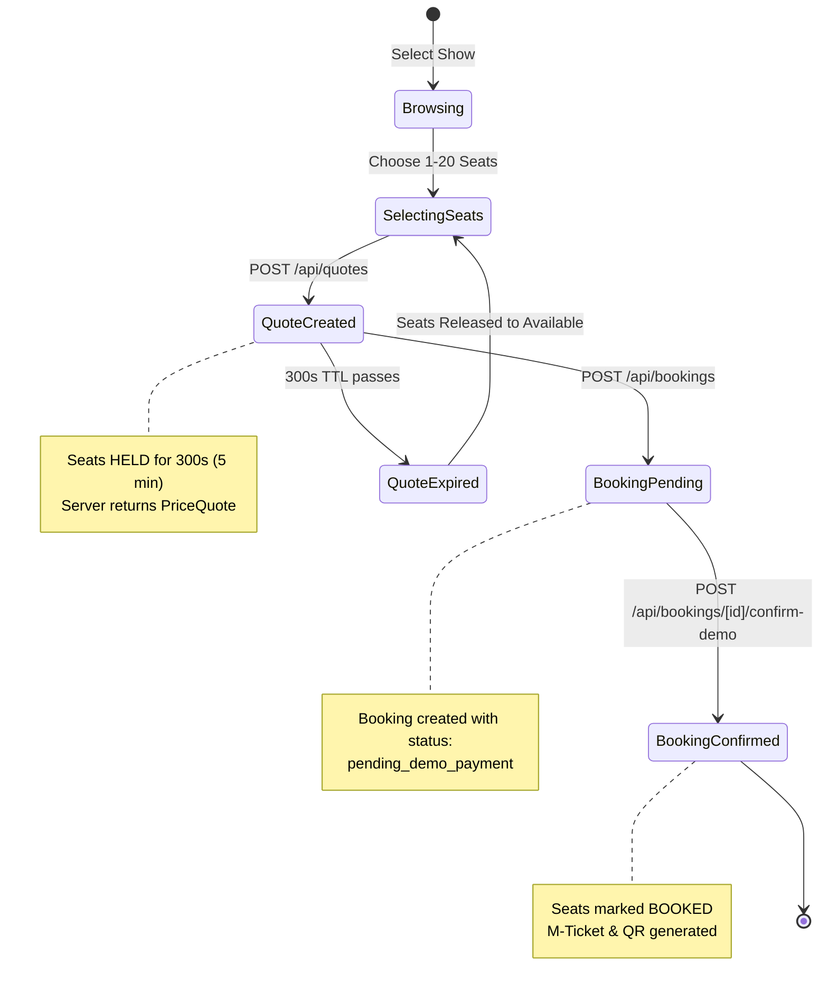

# CineSuno — Shared Integration Contract & Collaboration Agreement

**Document:** `CINESUNO_INTEGRATION_CONTRACT.md`  
**Signatories:** Developer A (Frontend Lead) & Developer B (Backend Lead)  
**Version:** 1.0  
**Effective Date:** October 2026

---

## 1. Core Architectural Ground Rules

1. **Backend is the Authoritative Source of Truth:**
   - The backend alone calculates seat prices, convenience fees, taxes, discount validations, quote expirations, and final payable totals.
   - The frontend NEVER implements independent booking state machines or independent financial math. The frontend may compute client-side estimates for display, but must always present the server quote before confirming a booking.
2. **Unified Domain Logic for Web & Voice:**
   - The Next.js web application and the Bolna AI voice agent execute the exact same backend services (`src/lib/pricing.ts`, `src/lib/seat-recommender.ts`, `src/lib/booking-engine.ts`). There is no bypass or separate path for voice.
3. **Integer Indian Paise Everywhere:**
   - All monetary figures across APIs, data models, state stores, and internal logic are represented as positive integers representing Indian paise ($1\text{ Rupee} = 100\text{ paise}$).
   - Example: ₹350.00 is strictly transmitted as `35000`. Floating-point currency values are strictly prohibited.
4. **Convenience Fee Invariant:**
   - Exactly ₹5 (500 paise) per ticket, strictly capped at a maximum of ₹30 (3000 paise) per booking:
     $$\text{convenienceFeePaise} = \min(\text{ticketCount} \times 500,\, 3000)$$
5. **Ticket Quantity Constraints:**
   - Supported ticket range is strictly 1 to 20 tickets per booking. Zero, negative, fractional, or $>20$ ticket selections are rejected immediately.
6. **Show-Dependent Availability:**
   - Physical seats in an auditorium are static fixtures (`Seat`).
   - Seat availability is strictly showtime-dependent (`ShowSeatAvailability`). Selecting or booking a seat for 6:00 PM does not affect availability for 9:30 PM.
7. **Show Switch Cleanses State:**
   - If a user changes their active show, the frontend immediately invalidates all selected seats (`selectedSeatIds = []`) and discards active quotes (`quote = null`).

---

## 2. Shared Data Models & TypeScript Specifications

All shared interfaces reside strictly in `src/types/index.ts`. Neither developer may edit this file without mutual review and explicit agreement.

### 2.1 Standard API Envelope: `ApiResponse<T>`
```typescript
export interface ApiSuccessResponse<T> {
  success: true;
  data: T;
  message?: string;
}

export interface ApiErrorResponse {
  success: false;
  error: {
    code: ApiErrorCode;
    message: string;
    field?: string;
    details?: Record<string, unknown>;
  };
}

export type ApiResponse<T> = ApiSuccessResponse<T> | ApiErrorResponse;
```

### 2.2 Standard Error Codes
- `BAD_REQUEST`: Malformed JSON or invalid query syntax.
- `INVALID_TICKET_COUNT`: Requested count is $<1$ or $>20$.
- `SEAT_UNAVAILABLE`: One or more requested seats are held or booked.
- `SEAT_DUPLICATE`: Same seat ID passed multiple times in request.
- `QUOTE_EXPIRED`: 5-minute hold time exceeded.
- `QUOTE_INVALID`: Seat count or show ID does not match quote.
- `BOOKING_NOT_FOUND`: Booking reference does not exist.
- `BOOKING_INVALID_STATE`: Attempting to confirm an already confirmed or expired booking.

---

## 3. 3D Auditorium Coordinate Conventions

To ensure the frontend Three.js scene renders accurately across all auditoriums, the backend provides standardized 3D Cartesian coordinates in `GET /api/shows/[id]/seats`:

- **Coordinate System:** Right-handed 3D Cartesian coordinates in meters.
- **Centerline Datum $(0, 0, 0)$:** Center of the auditorium floor directly in front of the screen.
- **Screen Location:** Center at $(0, 3.5, -15.0)$ with width $14.0\text{m}$, height $6.5\text{m}$, and curve radius $22.0\text{m}$.
- **Seat Coordinates $(x, y, z)$:**
  - $X$: Lateral position across the hall ($-7.5\text{m}$ to $+7.5\text{m}$).
  - $Y$: Elevation height off floor datum ($0.4\text{m}$ to $4.2\text{m}$, rising $0.38\text{m}$ per row).
  - $Z$: Longitudinal distance from screen ($0.0\text{m}$ for front Row A to $+14.0\text{m}$ for rear Recliners).

---

## 4. Booking & Quote State Machine



---

## 5. File Ownership Matrix

| Area | Lead Developer | Primary Directories & Files |
| :--- | :--- | :--- |
| **Frontend UI & Pages** | Developer A | `src/app/(customer routes)/**`, `src/components/**`, `src/lib/api-client.ts`, `src/mocks/**` |
| **Backend & Services** | Developer B | `src/app/api/**`, `src/lib/(engine/store/pricing/validation/voice-tools).ts`, `data/**` |
| **Protected Shared Files** | **Mutual Agreement** | `src/types/index.ts`, `src/app/globals.css`, `src/app/layout.tsx`, root configs, agent docs |

### Protocol for Modifying Shared Files
1. Developer proposing the change opens a proposal detailing the exact minimal diff.
2. Other developer reviews the rationale and verifies compatibility with their workstream.
3. Once explicitly approved, the changes are committed to the integration branch.

---

## 6. Mock Data & Isolation Strategy

To prevent development deadlocks:
- **Frontend Isolation:** Developer A may utilize isolated client mock fixtures (`src/mocks/**`) to design and polish UI components (3D scene, audio simulation, modals) before backend endpoints are live.
- **Backend Isolation:** Developer B may utilize direct API curl scripts and unit tests to verify backend route handlers before frontend UI components are wired.
- **Switchover Rule:** When an API route is confirmed functional with passing tests, Developer A removes the frontend mock adapter and points `src/lib/api-client.ts` to the authoritative endpoint.

---

## 7. Joint Verification Checkpoints

Development proceeds through 5 synchronized integration checkpoints:

| Checkpoint | Scope | Joint Verification Command | Acceptance Gate |
| :--- | :--- | :--- | :--- |
| **CP1: Contracts & Fixtures** | 3D seat coordinates, show schedules, movies | `npx tsc --noEmit` | Zero type errors in shared contracts. |
| **CP2: Showtimes & Layout** | Movie discovery, showtime picker, seat map | Browser inspection of `/shows?movieId=mov-01` | Shows and seat availability load from live API. |
| **CP3: Pricing & Hold Engine** | Quote generation, fee cap, 5-min TTL hold | `POST /api/quotes` curl test + UI drawer | Fee is ₹5/ticket (max ₹30); seats hold for 300s. |
| **CP4: Checkout & Booking** | Booking creation, demo confirmation, M-ticket | Complete checkout flow in browser | Valid booking reference generated; seats turn booked. |
| **CP5: 3D & Intelligence** | 3D auditorium view, spatial audio, voice tools | WebGL 60 FPS, Web Audio playback, voice test | Full end-to-end journey operational with zero regressions. |

---

## 8. Git Strategy & Branching

- **Integration Trunk:** `develop` (or active agreed development branch).
- **Frontend Work:** Branch `feature/frontend` branching from agreed trunk.
- **Backend Work:** Branch `feature/backend` branching from agreed trunk.
- **Commit Format:** Conventional Commits (`feat(frontend): ...`, `feat(backend): ...`, `fix(shared): ...`).
- **Zero Blind Force Pushes:** Destructive git commands (`git reset --hard`, `git push --force`) are strictly prohibited.
